# Habit Loop 🔄

A Flutter app for building good habits, quitting bad ones, and keeping your
to-dos and notes in one place, with an AI assistant you can talk to in English
or Bengali. Everything is stored on the phone; nothing needs an account.

## Screenshots

<table>
  <tr>
    <td align="center">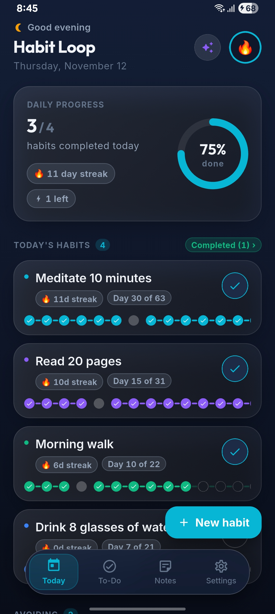<br><sub>Today: daily progress and habits</sub></td>
    <td align="center">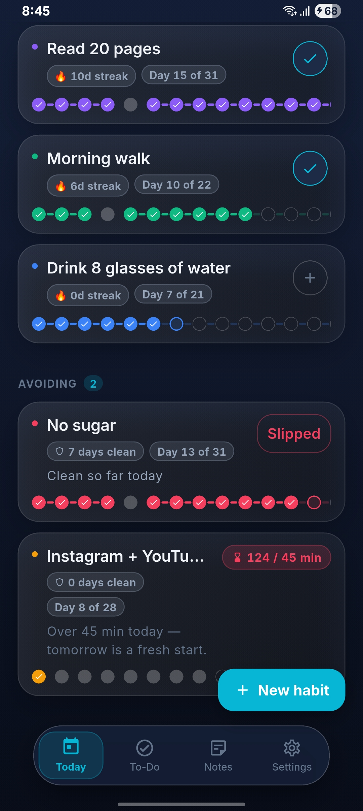<br><sub>Quit and screen-time habits</sub></td>
    <td align="center">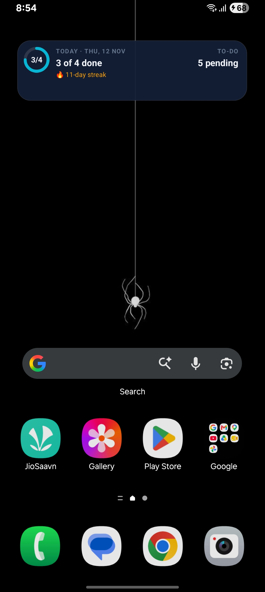<br><sub>Home screen widget</sub></td>
  </tr>
  <tr>
    <td align="center">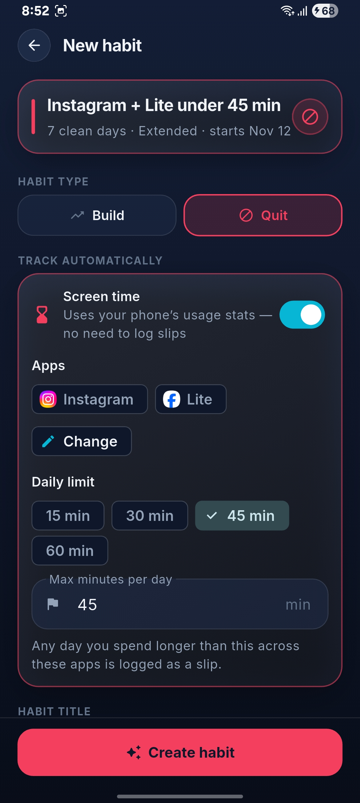<br><sub>New screen-time habit</sub></td>
    <td align="center">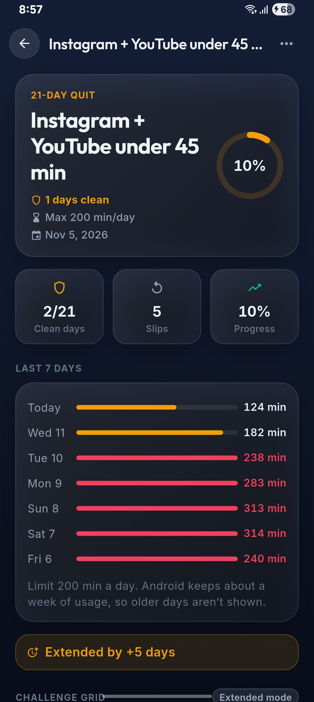<br><sub>Last 7 days of screen time</sub></td>
    <td align="center">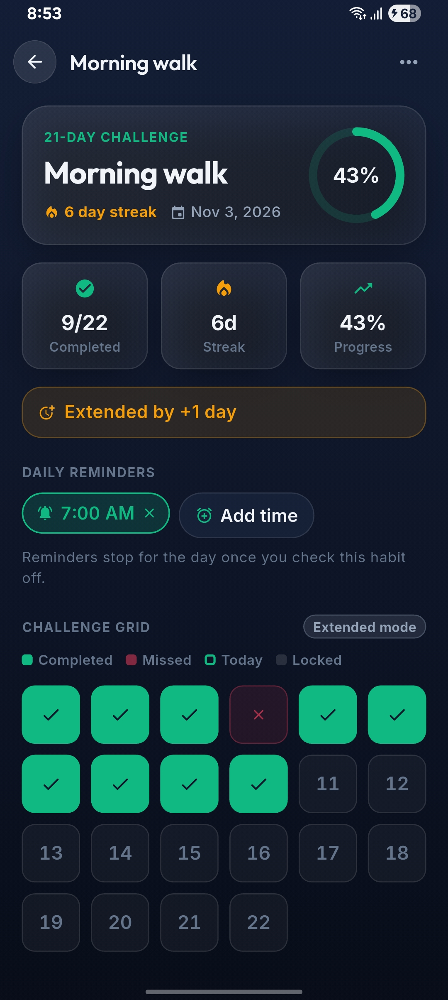<br><sub>Challenge grid and reminders</sub></td>
  </tr>
  <tr>
    <td align="center">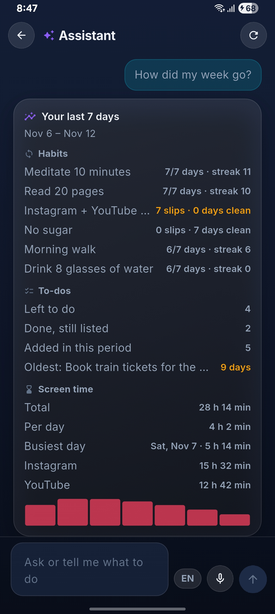<br><sub>Assistant: weekly report</sub></td>
    <td align="center">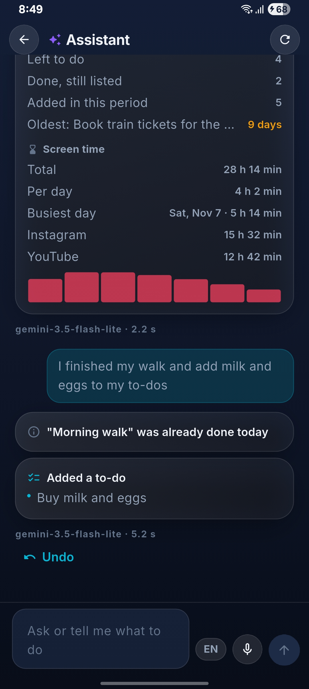<br><sub>Assistant: one request, two actions</sub></td>
    <td align="center">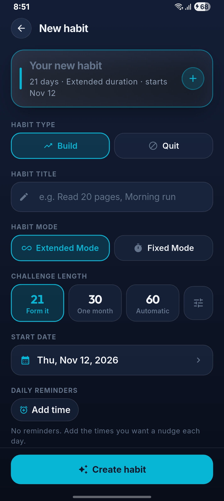<br><sub>New build habit</sub></td>
  </tr>
  <tr>
    <td align="center">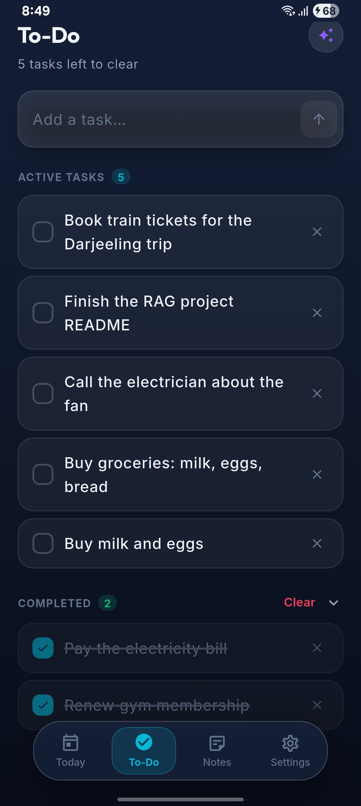<br><sub>To-dos</sub></td>
    <td align="center">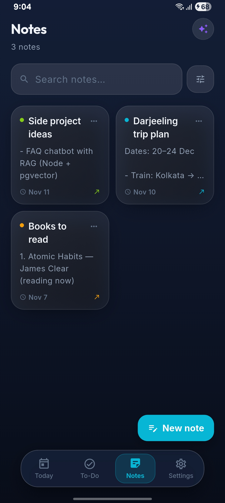<br><sub>Notes</sub></td>
    <td align="center">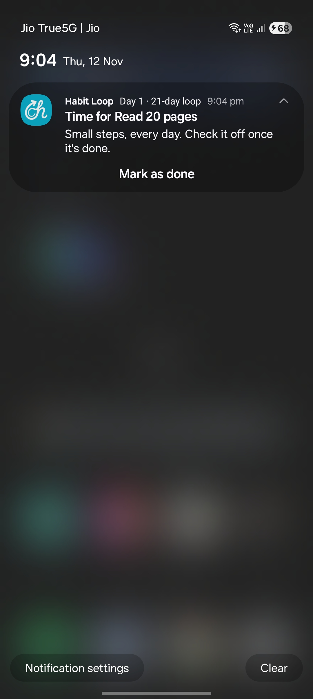<br><sub>Reminder with Mark as done</sub></td>
  </tr>
</table>

## Features

### Habits
- **Build habits** as day challenges (21, 30, 60 days or custom) with one-tap
  daily check-ins, streaks and a challenge grid.
- **Quit habits** work the other way round: every day counts as clean unless
  you log a slip. Strict mode restarts the count after a slip.
- **Screen-time habits** (Android) track themselves: pick apps such as
  Instagram and YouTube and a daily limit like 45 minutes. Any day over the
  limit becomes a slip automatically, and the Today card shows minutes used,
  e.g. "32 / 45 min".
- **Extended or Fixed mode**: missed days either extend the challenge or
  don't.
- **Screen-time alerts**: a notification when a screen-time habit has 10, 5
  and 1 minute left for the day, even while Habit Loop is closed.
- **Pause** a habit for a break without losing progress.

### AI assistant
- Type or speak a request, e.g. "I finished my walk and add milk to my
  to-dos", and the assistant does both through tool calls (Gemini).
- It can check in habits, log slips, add habits, manage to-dos and notes,
  change settings, and show reports ("How did my week go?", "How long was I
  on Instagram this week?").
- Safe by design: new habits wait for your OK, changes can be undone, habits
  can't be deleted through the assistant, and a note's contents are only sent
  if you choose to share it. Real ids never leave the phone.
- Uses your own free Gemini API key, kept in secure storage.

### More
- **To-do list** with quick capture.
- **Notes** with auto-save and instant search.
- **Voice dictation** in notes and the assistant.
- **Reminders** for Build habits, with a "Mark as done" action on the
  notification. Quit habits have no reminders.
- **Home screen widget** showing today's habits (Android).
- **Light, dark and system themes** from one design system
  ([docs/DESIGN_SYSTEM.md](docs/DESIGN_SYSTEM.md)).
- **Backup and restore** of habits, to-dos and notes as a JSON file.

## How screen-time tracking works

Android records when each app comes to the foreground and goes away. Habit
Loop reads those events through `UsageStatsManager`, adds up the minutes per
app per day (splitting sessions that cross midnight), and marks a slip on any
day over the habit's limit.

- It needs **Usage access**, which you turn on once in system settings. Unlike
  an accessibility service it can't see what's on screen, so banking and
  payment apps keep working normally.
- Alerts need no background service: each check sets one alarm for the
  earliest moment the next threshold could be crossed (usage grows at most a
  minute per minute), so checks are rare until the limit is close.
- Android keeps about **7 days** of usage history, so only the last week is
  re-checked; older slips stay as they were recorded.
- Android only; the option is hidden on other platforms.

## Permissions (Android)

| Permission | Why |
| --- | --- |
| Notifications, exact alarms | Habit reminders and screen-time alerts |
| Microphone | Voice dictation (asked the first time you tap the mic) |
| Internet | The AI assistant and online speech recognition |
| Usage access | Screen-time habits (asked only when you create one) |

## Built with

- **Flutter** (Dart), **Riverpod** for state
- **Hive CE** for local storage
- **Gemini API** (`http`) for the assistant, with function calling
- **Kotlin** platform channels for usage stats (`UsageChannel.kt`) and speech
  (`SpeechChannel.kt`)
- `flutter_local_notifications`, `home_widget`, `flutter_secure_storage`,
  `file_picker`, `intl`, `uuid`

## Project structure

```text
lib/
├── core/          # providers, services (Gemini, usage, notifications…), theme
├── data/          # Hive models and repositories
├── features/      # screens: today, add_habit, habit_detail, assistant, notes, todo, settings
└── widgets/       # shared components (cards, rings, pickers)
android/app/src/main/kotlin/…   # native channels and the home widget
docs/              # design system and feature plans
test/              # unit and widget tests
```

## Getting started

1. Clone the repository:
   ```bash
   git clone https://github.com/Sayantan414/Habit_Loop.git
   cd Habit_Loop
   ```
2. Install dependencies:
   ```bash
   flutter pub get
   ```
3. Run the app:
   ```bash
   flutter run
   ```
4. Optional: to use the assistant, get a free API key from Google AI Studio
   and paste it in **Settings → AI & voice**.

After changing a Hive model, regenerate the adapters:

```bash
dart run build_runner build --delete-conflicting-outputs
```

Run the tests:

```bash
flutter test
```
